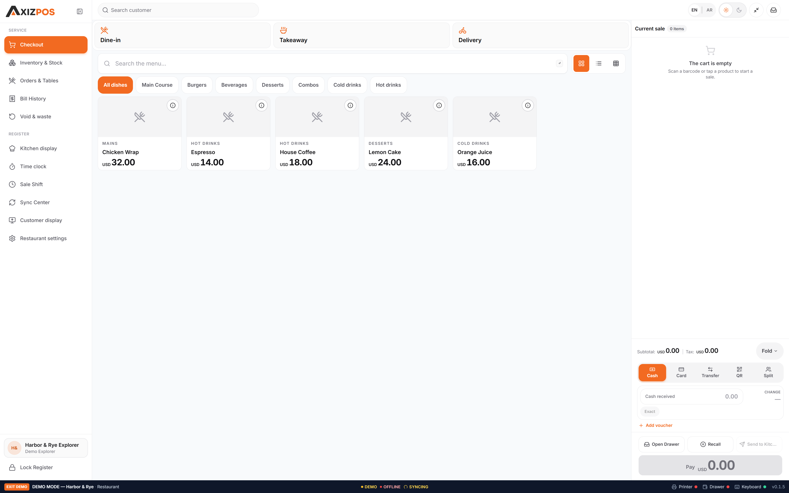
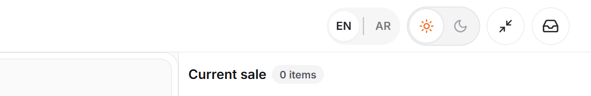
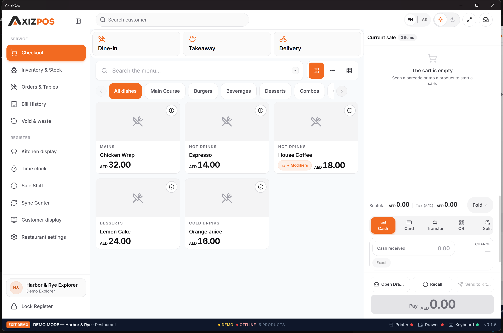
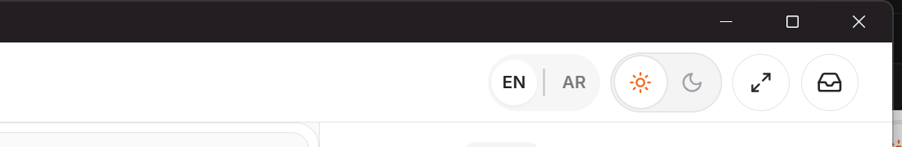
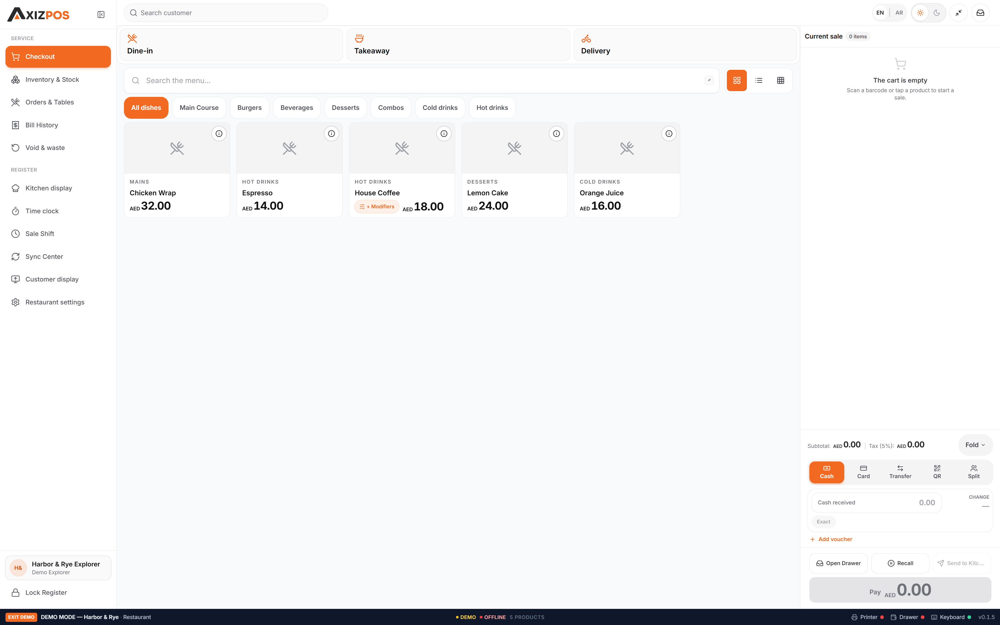

# POS default full-screen acceptance

Date: 25-11-2026

AxizPOS on Windows opens the main register window in native full-screen on every launch. A single navbar icon leaves full-screen and returns to it. The choice lasts until the process exits. The next launch is full-screen again. This does not use kiosk mode, the browser Fullscreen API, or a second window.

Result: **PASSED**

## Default startup

The main window is created hidden (`visible: false` in `apps/desktop/src-tauri/tauri.conf.json`). After the native window exists, and before it is shown, Rust calls Tauri `set_fullscreen(true)` and hides the title bar. The window is then shown and focused. Activation, PIN unlock, and the offline register all appear inside that same window. Full-screen does not wait for the API.

If `set_fullscreen` fails, the window is shown with its title bar and borders so the register stays usable.

A windowed session is kept in memory only. `persisted_windowed_preference()` is `None`. Nothing is written for the next launch.

## Native Tauri implementation

`apps/desktop/src-tauri/src/window_mode.rs` owns the main window (`label: "main"`).

| Command | Role |
|---|---|
| `window_fullscreen_state` | Reads `is_fullscreen` |
| `window_set_fullscreen` | Enters or leaves full-screen |
| `window_toggle_fullscreen` | Switches, and returns the state after the change |

Entering full-screen turns decorations off, then calls `set_fullscreen(true)`. That is Tauri borderless full-screen on the monitor that currently holds the window. It does not change the display mode and it does not lock Windows.

Leaving full-screen turns decorations on, calls `set_fullscreen(false)`, then restores the saved frame. A second request is rejected while one change is in progress (`A screen change is already in progress.`). A failed change clears full-screen and restores the title bar.

The window emits `pos-fullscreen-changed` when the native state changes. Resize and scale-factor events publish the same state when no change is already running. The navbar listens for that event and also reads the command on load, so the icon follows the real window.

## Navbar toggle

One button in the register header, between the theme control and the cash-drawer control. It uses the same compact round style as the drawer button.

| Window | Icon | Accessible name and tooltip |
|---|---|---|
| Full-screen | Lucide `Minimize2` (exit full-screen) | `Exit Full Screen` |
| Windowed | Lucide `Maximize2` (enter full-screen) | `Enter Full Screen` |

The button is keyboard-focusable, exposes `aria-pressed`, and advertises `F11`. F11 calls the same native toggle. Escape is not handled here, so sale dialogs and the register keep their existing Escape behavior.

The button is omitted in a browser preview, where there is no native window.

## Window restoration

Before the first full-screen of a session, the outer position and size are remembered. A maximized window is remembered as maximized, and its normal frame is kept. On exit:

- The title bar, borders, and resize frame come back.
- A normal window is returned to the saved outer size and position when that rectangle still sits on a monitor.
- A position that misses every current work area is centered on the current monitor. The saved size is kept when it fits, and clamped when it is larger than the work area.
- A maximized window is maximized again on the current display.

The register is not minimized or closed by the toggle.

## Multi-monitor and zoom

Full-screen uses the monitor that contains the window. Re-entering uses that current display.

The live Windows run was on one panel:

| | |
|---|---|
| Monitor | 3840 × 2400 physical |
| Work area | 3840 × 2316 (taskbar at the bottom) |
| DPI | 168 (175%) |

Full-screen covered the monitor, with no title bar. The catalogue, cart, navbar, and bottom status bar were on screen. The windowed restore kept one outer size, 2568 × 1703, which is the configured 1440 × 900 logical window plus the Windows title bar and borders at 175%.

1366 × 768, 1920 × 1080, 2560 × 1440, 200% DPI, a disconnected monitor, and an off-screen position are covered by the restoration tests. No second monitor was attached during the live run.

Layout sizes stay on the existing rem scale. The toggle does not set a fixed resolution.

## Keyboard

- F11 toggles native full-screen. It is ignored when held with Ctrl, Alt, Shift, or the Windows key, and key-repeat is ignored.
- Escape is unchanged.
- Alt+F4 still closes the register. The Windows key still opens the taskbar and Start menu. Task Manager is not blocked.

While full-screen, the native minimize, maximize, and close buttons are hidden with the title bar. They return as soon as the window is windowed.

## Automated tests

Desktop TypeScript, from `apps/desktop`:

`pnpm exec tsc -p tsconfig.json --noEmit` — exit 0

Vitest, `src/lib/fullscreen.test.ts` and `src/components/shell/screenToggle.test.tsx`:

10 passed (startup full-screen, relaunch, icon and tooltip text, native-state updates, repeated toggle, ignored duplicate toggle, command failure, F11, Escape left alone, one navbar control beside language, theme, and the drawer).

Rust, from `apps/desktop/src-tauri`:

`cargo test --lib window_mode` — 12 passed

- Full-screen on startup, including when the API is down
- No saved windowed preference
- Relaunch is full-screen and does not reuse the previous session's windowed frame
- Enter, exit, and repeated toggle keep the windowed frame
- Maximized restore
- Unchanged request does not move the window
- Native failure leaves a normal window
- A second toggle is rejected while one is in progress
- 1920, 2560, and 3840 work areas keep a fitting frame
- A 1440 × 900 frame is fitted to a 1366 × 728 work area
- A frame on a removed monitor is placed on the current display
- An off-screen position is brought back onto a monitor
- A valid position on a secondary monitor is kept

## Native Windows run

Executable, not installed and not signed as a setup package:

`apps/desktop/src-tauri/target/release/ai-pos-desktop.exe`

SHA-256: `D5B7A371D269A2D3CC5E70FB574ABF948FC6FB7085CF93177C1E5A60FA1B6E93`

Size: 22,287,872 bytes

Built with `pnpm exec tauri build --no-bundle`. No installer was produced and nothing was deployed.

| Step | Result |
|---|---|
| Launch | 0,0 3840 × 2400, no caption, no resize frame |
| F11 | 44,44 2568 × 1703, caption and resize frame restored |
| F11 again | 0,0 3840 × 2400, no caption |
| Process restarted | 0,0 3840 × 2400, no caption |
| Navbar icon click | Left full-screen into a decorated 2568 × 1703 window |
| Navbar icon click again | Returned to 0,0 3840 × 2400 with no caption |

The open register was the existing Harbor & Rye demo. Checkout, the cart, and the status bar stayed in place. Printer, drawer, and sync code were not changed.

## Known limitations

- Full-screen covers the whole monitor, including the taskbar strip. The taskbar is still available from the Windows key. This is borderless full-screen, not a locked kiosk.
- The native minimize and close buttons are hidden for as long as the title bar is hidden. Alt+F4 still closes the register. Leaving full-screen brings the title bar back.
- The live check used this PC's 3840 × 2400 panel at 175% DPI. Other sizes were checked in the restoration tests, not on extra hardware.
- No second monitor was connected, so moving a window between panels was not exercised live.
- The screen button is not shown when the register UI is opened in a browser tab.
